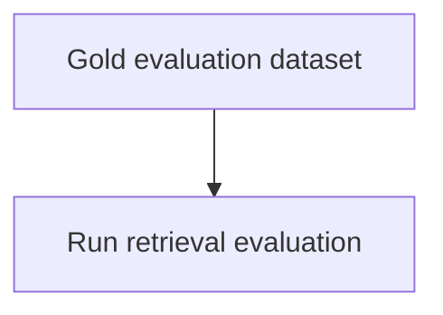

# Flowchart colors

`doc-infrastructure/scripts/fern_mermaid.py` adds shared colors to flowchart diagrams. You assign a class to each node. The script reads the colors from [`mermaid-theme.json`](mermaid-theme.json) and writes them into a copy of the site. Files under `fern/` stay as you wrote them.

The copy is `.generated/fern/`. Use it to preview colors locally. The folder is gitignored. Diagram edits, new diagrams, and palette changes publish through git: commit them, integrate into `main`, and push. CI stages this copy and publishes it. Do not publish with `python3 doc-infrastructure/scripts/fern_mermaid.py publish`.

## Assign a class in the diagram

In a `flowchart` or `graph` block, label each node and assign one palette class:

````mdx

````

One `class` line can name several nodes: `class A,B,F core`.

Leave color definitions out of the page. If a diagram still has a `classDef` for a palette class, the script drops that line in the copy and writes the palette definition instead. A `classDef` for any other name is left as written.

## Classes

| Class | Use for |
| --- | --- |
| `core` | Processing steps, service components, and workflow actions |
| `vector` | Qdrant and vector storage |
| `lexical` | Lexical corpus and lexical data |
| `artifact` | Retrieved chunks, datasets, proposed answers, and other intermediate results |
| `output` | Generated answers, reports, and successful outcomes |
| `external` | OpenAI, Voyage AI, and other external services |
| `failure` | Failed operations, rejected results, and alerts |
| `automation` | n8n workflows, job coordination, and automation |

The same class means the same role on every page. Add a class in `mermaid-theme.json` when none of these fits. See the style guide for when to use a diagram.

## What the script writes

For each `.md` and `.mdx` file, the script finds ` ```mermaid ` blocks. A block that contains `flowchart` or `graph` gets one `classDef` line per palette class, appended at the end. Each line includes these properties when the class defines them:

- `fill`, `stroke`, and `color` — each a 6-digit hex color, such as `#EAF4FF`
- `stroke-width` — optional, written like `2px`

Any other key in the JSON is skipped. `external` has `stroke-dasharray`, and that value doesn't appear in the copy.

A styled `core` node looks like this in the copy:

```text
classDef core fill:#EAF4FF,stroke:#79BCEB,color:#123A75
```

Sequence diagrams and other Mermaid types are copied unchanged. Files that aren't Markdown are copied unchanged. A file removed from `fern/` is removed from the copy on the next run.

The theme file must have `"version": 1` and a `classes` object. Each class name starts with a letter and may contain letters, numbers, `_`, and `-`.

## Commands

Run these from the repository root. They need the Fern CLI. They don't need extra Python packages.

```bash
# Build the colored copy and leave it in .generated/fern/
python3 doc-infrastructure/scripts/fern_mermaid.py prepare

# Rebuild the copy about every 0.75 seconds, then run fern docs dev inside it
python3 doc-infrastructure/scripts/fern_mermaid.py dev

# Check the copy, or create a hosted preview
python3 doc-infrastructure/scripts/fern_mermaid.py check
python3 doc-infrastructure/scripts/fern_mermaid.py preview
```

`dev` re-reads `mermaid-theme.json` and the pages on each pass. Stop it with Ctrl+C. `check` runs `fern check`. `preview` runs `fern generate --docs --preview`.

Publish through git. Commit page changes under `fern/` and palette changes in `mermaid-theme.json`, then integrate them into `main` and push. On that push, CI runs `prepare` and publishes `.generated/fern/`. The same publication runs when CI is started manually on `main`.

For any other local Fern command, run `prepare`, then run that command with `.generated/fern` as the working directory.

Check the result in Fern light mode and dark mode.
