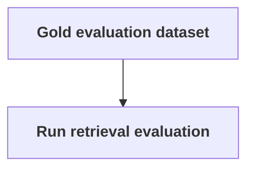

# Shared Mermaid styling for Fern

This package provides a Python preprocessor that inserts shared Mermaid `classDef` rules into **generated copies** of MDX pages. Authored files under `fern/` stay unchanged. Python's standard library is sufficient.

## Install

Copy `doc-infrastructure/scripts/fern_mermaid.py` into your repo. Keep your **existing, updated** `doc-infrastructure/diagram-styles/mermaid-theme.json` as the authoritative palette; the JSON included in this ZIP is the original example and should **not overwrite** your newer version.

Your repository should look like:

```text
python-rag-service/
├── fern/
│   ├── docs.yml
│   └── docs/
└── doc-infrastructure/
    ├── diagram-styles/
    │   └── mermaid-theme.json
    └── scripts/
        └── fern_mermaid.py
```

Add this to the repository's `.gitignore`:

```gitignore
.generated/
```

## Author diagrams without colors

````mdx

````

Remove any existing palette-managed `classDef` declarations from authored diagrams when convenient. The preprocessor also removes and replaces them in staged copies, so existing pages continue to work during the transition.

## Commands (from the repository root)

```bash
# Create a styled copy for inspection
python doc-infrastructure/scripts/fern_mermaid.py prepare

# Run Fern's local dev server, continuously syncing your edits
python doc-infrastructure/scripts/fern_mermaid.py dev

# Publish with styled copies (same idea as fern generate --docs)
python doc-infrastructure/scripts/fern_mermaid.py publish

# Create a hosted preview with styled copies
python doc-infrastructure/scripts/fern_mermaid.py preview

# Validate the staged Fern site
python doc-infrastructure/scripts/fern_mermaid.py check
```

The output goes to `.generated/fern/`. Use the wrapper commands **instead of** invoking Fern directly when you need injected styles. During `dev`, edits to source MDX and `mermaid-theme.json` are propagated to the staged directory automatically. Stop the dev server with Ctrl+C.

To run a different Fern CLI command, first run `prepare` and then execute that command from inside `.generated/fern`.

## Production integration

If CI currently runs `fern generate --docs` directly, replace that step with:

```bash
python doc-infrastructure/scripts/fern_mermaid.py publish
```

This wrapper has not been tested against your actual Fern repository or deployment pipeline. Check whether your `fern/docs.yml` or build config references files **outside** the `fern/` directory; if it does, the staging approach may need to copy or adjust those paths. Confirm the generated site looks correct locally before changing CI. Also verify that your Fern CSS is applied to staged builds.

## Notes

- Only flowchart blocks (`flowchart` or `graph`) get generated class definitions. Other Mermaid diagram types are left unchanged.
- A class assignment like `class A core` is still needed on individual diagrams; only the color definitions are centralized.
- The script validates hex values and recognized styling properties. To change the palette, edit the JSON, not every diagram.
- The script doesn't edit source files, nor does it require installing third-party Python packages.
- It doesn't hook into `fern docs dev` automatically; use the `dev` wrapper command above.
- Styling should be tested in both Fern light and dark modes.
