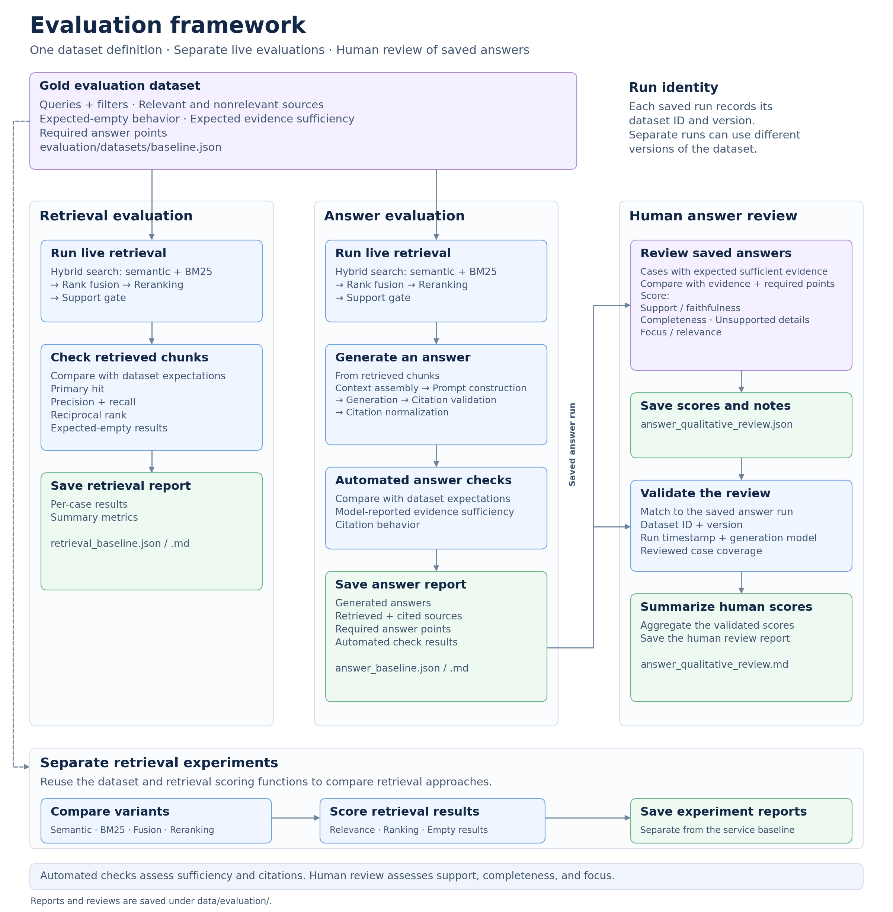
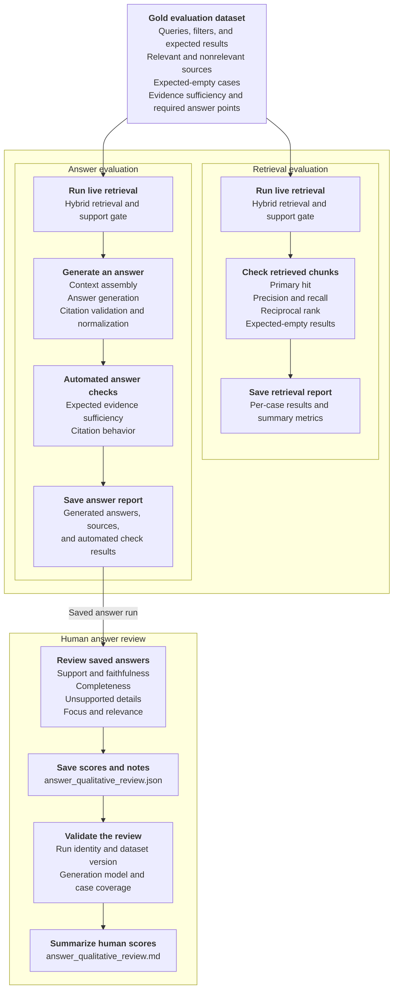
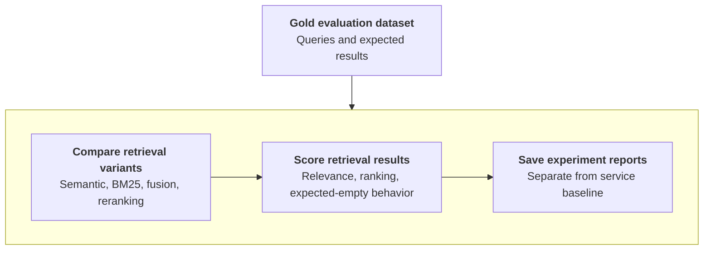

The Python RAG Service uses one versioned dataset for retrieval and answer evaluation. Two commands independently run
the service’s Python components against the live index and save separate reports. A person reviews selected answers
from the saved answer report. Separate retrieval experiments reuse the dataset and write their own reports.

The diagram shows how the dataset feeds both evaluation paths. The saved answer report supplies the answers, evidence,
and required points for human review. The dashed line connects the dataset to separate retrieval experiments.

{/*<Frame caption="Python RAG Service evaluation architecture">
  
</Frame>**/}

<figure>

<figcaption>Python RAG Service evaluation framework</figcaption>
</figure>

## The shared dataset

Both live evaluations load `evaluation/datasets/baseline.json`. The project ships this file as an example dataset
for The Doc Landscape WordPress corpus, with ID `doc-landscape-baseline` and version `1.7`. These values identify
the bundled example. Each test case has a query, optional filters, retrieval expectations, and, in the bundled
example, an answer expectation.

Create your own dataset for your indexed content and user questions, with its own ID and version. Use the example
to understand the format, then define your own queries, source judgments, and answer expectations.
[Run the evaluation](/docs/evaluate/run-the-evaluation#prepare-your-dataset) explains how to place your dataset
at the path the commands read, or use the bundled example with an index of The Doc Landscape’s public content.

The retrieval expectation names relevant and nonrelevant sources and sets `expect_empty`. The answer expectation
sets `expected_sufficient_evidence` and lists required points for human review. Reports copy the dataset ID and
version, so a later run can use a different version of the same file.

## Retrieval evaluation

`rag_service.commands.evaluate_retrieval` runs each case’s query through the service’s retrieval pipeline and
requests up to 5 chunks.

It then compares those chunks with the case's retrieval expectation. The comparison records primary-source hits,
precision, recall, reciprocal rank, and whether an expected-empty case returned no chunks. The command writes
`data/evaluation/latest/retrieval_baseline.json` and `data/evaluation/latest/retrieval_baseline.md`.

[Retrieval evaluation](/docs/evaluate/retrieval-evaluation) defines those metrics and the case success rule.

## Answer evaluation

`rag_service.commands.evaluate_answers` starts with the same retrieval call. It then generates an answer from the
retrieved chunks. Generation includes context assembly, the grounded prompt, the model response, citation
validation, and citation normalization. The application validates citations. The evaluation command compares the
finished answer with the case.

The automated checks compare the model-reported `sufficient_evidence` value with `expected_sufficient_evidence` and
check citation behavior against the case’s source judgments and expected evidence sufficiency. The command saves
required points for human review; automated checks don’t assess whether the answer covers them.

The command writes `data/evaluation/latest/answer_baseline.json` and `data/evaluation/latest/answer_baseline.md`. The JSON file
contains the saved answer run.

[Answer evaluation](/docs/evaluate/answer-evaluation) defines the structural checks.

## Why the two evaluations stay separate

Retrieval evaluation and answer evaluation measure different failures. For a multi_section case, retrieval evaluation
requires every primary source. The answer’s structural checks can pass when its citations include one primary source,
even if another is missing. Human review can then identify missing required points or an answer that drifts off the question.
Separate reports make these outcomes visible.

[How evaluation works](/docs/evaluate/how-evaluation-works) shows the cases behind that split.

## Expected-empty cases

An expected-empty case sets `expect_empty` to `true` and lists no relevant sources. The bundled example dataset pairs that
flag with `expected_sufficient_evidence` set to `false`. The dataset model doesn't require the two fields to match.

Retrieval evaluation runs the case through the current retrieval pipeline, including the support gate. The case passes
when retrieval returns no chunks. Answer evaluation makes its own retrieval call, generates an answer from the returned
chunks, and checks for a model-reported `sufficient_evidence` value of false and no citations.

[Retrieval pipeline](/docs/architecture/retrieval-pipeline) explains the support gate.

## Human review

A person reviews the saved answers for cases whose saved answer expectation sets expected_sufficient_evidence to true.
The reviewer compares each answer with the retrieved evidence and required points stored in the answer report, then scores
support and faithfulness, required-point completeness, unsupported details, and focus. Scores and notes are stored in
`data/evaluation/latest/answer_qualitative_review.json`.

`rag_service.commands.report_qualitative_answers` doesn't score the answers. It validates that the review
identifies the saved answer run and covers exactly the required cases, then summarizes the scores, then writes
`data/evaluation/latest/answer_qualitative_review.md`. The check compares dataset ID, dataset version, the answer report's
`generated_at` timestamp, and the generation model. The reviewed case IDs must be exactly the cases whose
`expected_sufficient_evidence` is `true`.

[Answer evaluation](/docs/evaluate/answer-evaluation) defines how to apply the four scores.

## Retrieval experiments

<figure>

<figcaption>Python RAG Service evaluation retrieval experiements</figcaption>
</figure>

These commands compare individual retrieval stages and experimental configurations using the same dataset and
retrieval scoring function. They use the same dataset and the same retrieval scoring function. Each one writes
its own JSON and Markdown files under `data/evaluation/retrieval-experiments/`. Those files aren't `retrieval_baseline` or
`answer_baseline`, and human review doesn't match them.

- `evaluate_bm25` retrieves with BM25 only and keeps the top five matches.
- `evaluate_hybrid` runs vector retrieval and BM25 retrieval, then combines the two ranked lists with reciprocal
  rank fusion. It doesn't rerank that combined list.
- `evaluate_reranking` takes vector-retrieval candidates, reranks them, and keeps the top five.
- `evaluate_hybrid_reranking` combines vector and BM25 results and reranks the combined list. It scores the raw
  top five results and separately evaluates a provisional query-level support cutoff of 0.70.

`evaluate_bm25`, `evaluate_hybrid`, and `evaluate_reranking` don't apply a support cutoff, so they don't score
whether an expected-empty case returned no chunks. The production retrieval command does, because it runs the
service's support gate.

## Saved artifacts

Both baseline reports record the dataset ID and version, run timestamp, Qdrant collection, embedding model,
support cutoff, and requested chunk count. The answer report also records the generation model. Separate runs
can use different dataset versions. When comparing runs, use the same dataset ID and version and account for changes
to the indexed content, models, and retrieval settings.

Each baseline command overwrites its report files. Save copies before rerunning if you need to retain an earlier
run. A human review must match the saved answer report being checked. Baseline reports and human-review files are stored
under `data/evaluation/latest/`. Git ignores `/data/`, so these files aren’t committed by default.
[Evaluation framework reference](/docs/reference/evaluation-framework-reference) lists their fields.

## Next steps

**[Run the evaluation](/docs/evaluate/run-the-evaluation)**: Produce a retrieval run, an answer run, or the
qualitative report using your own dataset or the bundled example.

## Related pages

- **[Retrieval evaluation](/docs/evaluate/retrieval-evaluation)**: Look up retrieval metrics and the case success rule.
- **[Answer evaluation](/docs/evaluate/answer-evaluation)**: Look up the structural checks and the qualitative scores.
- **[Current evaluation results](/docs/evaluate/recorded-evaluation-results)**: Read the recorded results for the bundled example dataset.
- **[How evaluation works](/docs/evaluate/how-evaluation-works)**: See what the dataset measures and why the checks stay separate.
- **[Evaluation framework reference](/docs/reference/evaluation-framework-reference)**: Look up the dataset, report, and human-review fields for this architecture.
