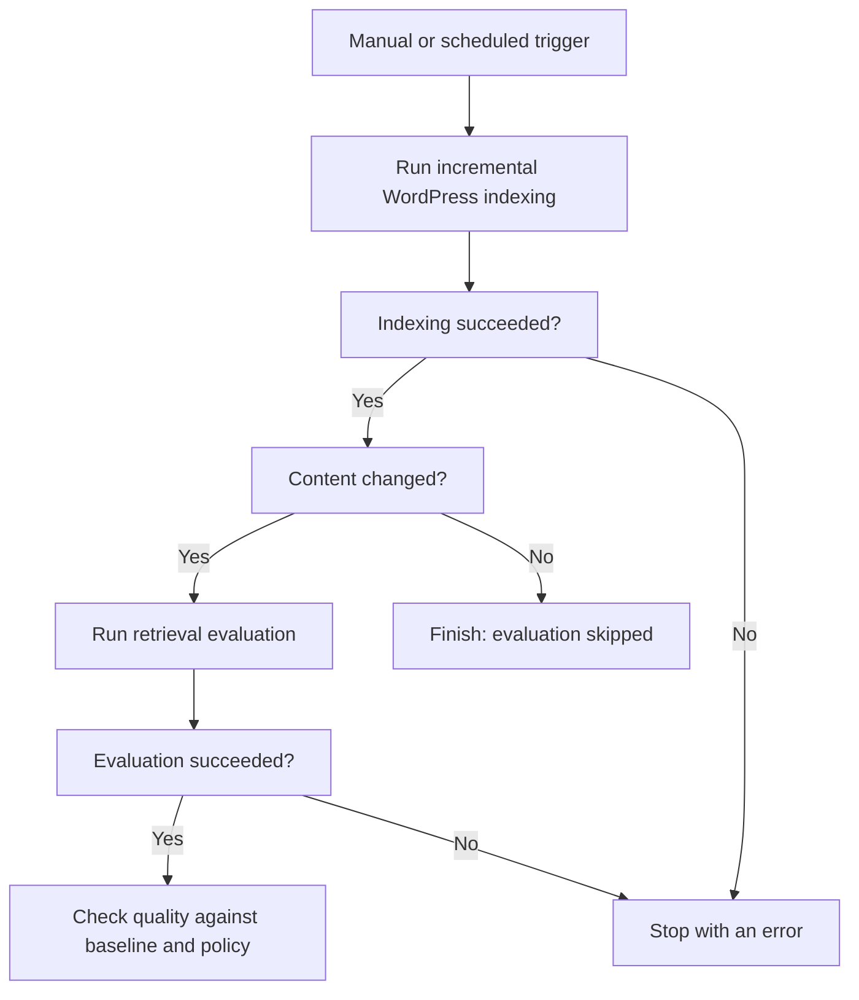
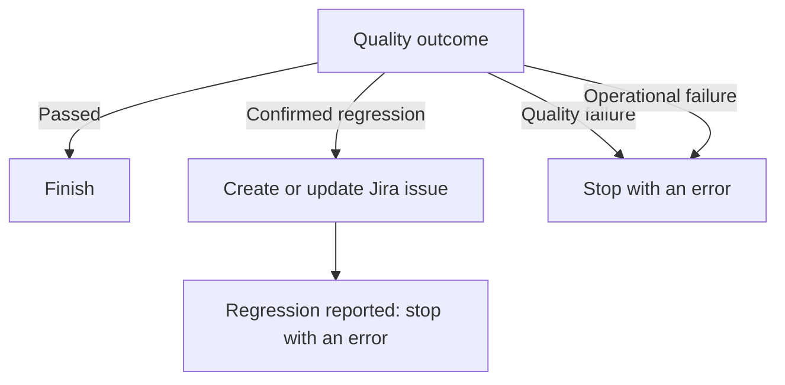

The optional n8n workflow keeps WordPress content indexed and checks retrieval
quality after content changes. It coordinates the Python RAG Service operations
runner, compares evaluation results with an approved baseline, and reports
confirmed regressions in Jira.

Read the [Operations overview](/docs/operations/overview) for the relationship
between the runner and n8n. For deployment and credentials, see
[Set up n8n workflow](/docs/operations/set-up-n8n-workflow).

## How n8n and the operations runner divide the work

The operations runner performs two operations: incremental WordPress indexing
and retrieval evaluation. Each submitted operation becomes a job with its own
ID, status, and result. The runner saves evaluation reports and returns their
paths, aggregate metrics, failed test case IDs, and retrieval configuration.

n8n controls the sequence around those jobs. It decides when to submit evaluation,
applies the retrieval quality policy, and routes findings. One workflow execution
can therefore contain both an indexing job and an evaluation job.

A job with `status: succeeded` finished its operation and saved the required
outputs. An evaluation job can succeed
while retrieval test cases fail. The quality comparison in n8n determines whether
the completed evaluation meets the policy.

## The workflow from trigger to outcome

Both the manual trigger and the schedule start the same flow. The exported
schedule runs daily at 14:00 in the configured schedule timezone. First, n8n reads
the policy and approved baseline from the mounted policy directory and retains
that pair for the execution. Loading, parsing, or initial validation errors stop
execution before indexing starts.

n8n submits `index_wordpress` through the operations API, then polls the returned
status URL. For `queued` or `running`, it waits before checking again. A `failed`
or unexpected status stops the workflow. On success, n8n inspects
`changes_detected`, which is true when indexing reports new, updated, or removed
documents.

If nothing changed, the execution ends without evaluation or a quality decision.
Otherwise, n8n submits `evaluate_retrieval` and polls it in the same way. Only a
successful evaluation reaches quality comparison.

### Indexing and evaluation

The indexing and evaluation diagram shows when the workflow continues, stops,
or skips evaluation. Each job stage includes submission, waiting, and status
polling.

<figure>

<figcaption>Indexing and evaluation: The workflow evaluates retrieval only after
successful indexing detects content changes.</figcaption>
</figure>

### Quality outcomes and reporting

After evaluation succeeds, the workflow checks its results against the approved
baseline and quality policy. The quality outcomes diagram shows how that decision
determines reporting and completion.

<figure>

<figcaption>Quality outcomes and reporting: Passing results end the workflow
successfully. Other outcomes stop it with an error, with qualifying regressions
reported in Jira first.</figcaption>
</figure>

A confirmed regression is a quality failure that qualifies for Jira reporting.
After reporting it, the workflow deliberately stops with an error. In both
diagrams, an error stops a manual execution. An automatic execution can also
invoke the configured failure-alert workflow.

Policy-loading errors, request failures after retries, and Jira errors also stop
execution. See [What happens when a step fails](#what-happens-when-a-step-fails)
for the alert behavior and recovery implications.

### Job submissions and retries

When n8n asks the runner to start a job, the runner may accept the request even
if its response never reaches n8n. Retrying that request could otherwise start
the same work twice.

To avoid this, n8n includes an **idempotency key**: a label that lets the runner
recognize a repeated request. When n8n sends the same key for the same operation,
the runner returns the existing job and its status instead of starting another
job. This also applies when the existing job has already finished or failed.

For indexing, n8n builds the key from the workflow execution ID, so starting a
new workflow execution allows a new indexing job. For evaluation, n8n builds the
key from the indexing job ID, so repeated evaluation requests for that indexing
job refer to the same evaluation job.

If a request to submit a job or check its status fails, n8n waits five seconds
before trying again. Checking a job that's still queued or running is different:
n8n waits and checks again because the accepted job hasn't finished yet.

The runner accepts only one active job at a time. A competing submission receives
a busy response rather than entering a waiting queue. If the configured request
retries can't obtain a successful response, the workflow stops. See
[Run the operations runner](/docs/operations/run-operations-runner) for job status
and retry details.

## How retrieval quality is judged

The **approved baseline** is a reviewed set of retrieval evaluation results.
It provides a fixed comparison point for deciding whether retrieval quality has
declined after content changes. The **retrieval quality policy** defines which
evidence is required and what changes are acceptable.

The workflow reads the baseline and policy from `approved-retrieval-baseline.json`
and `retrieval-quality-policy.json` under `automation/n8n/policies/`. The files
included in the repository describe this project's dataset and retrieval setup.
Use them as examples when preparing the files for your own deployment.

Create an evaluation dataset with queries and expected results for your own
content, then evaluate it against your indexed content and retrieval configuration.
After reviewing and approving those results, record them in your deployment's
`approved-retrieval-baseline.json`, including the dataset identity and version,
metrics, known failed cases, and evidence of the configuration used. Don't reuse
the example baseline's scores, known failures, or configuration verification as
evidence for your own deployment.

Review `retrieval-quality-policy.json` as well. Its metric minimums and allowed
declines should reflect your quality requirements and evaluation results. Keep
the files compatible with the workflow: its **Compare retrieval quality** step
supports schema version 1 and policy version 1. It compares each new evaluation
with your approved baseline using those rules. See
[Run the evaluation](/docs/evaluate/run-the-evaluation) for dataset and evaluation
setup.

### Establish whether results can be compared

Before judging quality, n8n checks dataset identity and version, case counts,
retrieval depth, and the recorded retrieval configuration against the baseline.
Configuration includes the collection, models, candidate depths, fusion setting,
support cutoff, and lexical corpus path. Source content doesn't have to remain
unchanged: checking the effect of content changes is the purpose of this flow.

The comparison also requires all five policy metrics, complete precision
judgments for answerable test cases, and evidence identifying failed cases.
The runner supplies that evidence as `failed_case_ids`.

Missing or null required metrics, incomplete coverage, missing comparison
metadata, or a dataset or configuration mismatch require review. Malformed
metrics, such as values outside 0 to 1, and contradictory counts or case outcomes
are operational failures. Neither condition establishes a confirmed regression.

### Apply metric and test case rules

For comparable, complete results, each metric must meet its minimum and stay
within its allowed decline from the baseline. The included policy defines:

| Metric | Minimum | Maximum decline |
| --- | --- | --- |
| Mean precision at k | 0.90 | 0.03 |
| Mean recall at k | 0.70 | 0.03 |
| Mean reciprocal rank | 0.85 | 0.05 |
| Hit rate at k | 1.00 | 0.00 |
| Unanswerable accuracy | 1.00 | 0.00 |

A decline is how much a score has dropped from the approved baseline. For
example, a drop from 0.95 to 0.92 is a decline of 0.03, or three percentage points.
A score can drop by exactly the allowed amount and still pass the decline check.
It must also meet the minimum score. Matching that minimum exactly is enough,
and higher scores also pass that check.

The quality check uses the full recorded values without rounding them first.
Its calculation preserves exact decimal boundaries so a score at the limit does
not fail because of a small calculation error. The policy sets these limits for
this project's initial local setup. Other deployments may need different limits based
on their own evaluation results.

A failed test case absent from the baseline's known-failure list also causes a
quality failure. Existing known failures remain visible but don't by themselves
fail the policy. For example, the included dataset 1.7 baseline records
`multi-section-001` as a known failure. That recorded exception is specific to
this baseline, not a guarantee about current results.

A quality pass, improved metrics, or resolution of a known failure doesn't
replace the approved baseline. Replacement requires explicit review. Changes to
dataset labels or references require a new dataset version and baseline review.
See [Retrieval evaluation](/docs/evaluate/retrieval-evaluation) for metric and
test case interpretation.

## What each quality outcome means

The quality check considers outcomes in the order listed in the table. It checks
that the results are complete and valid before deciding whether quality passed
or retrieval regressed.

| Quality outcome | Meaning | Workflow route |
| --- | --- | --- |
| `operational_failure` | The quality check finds invalid policy data or malformed or contradictory evaluation evidence. | Stop with an error; no Jira regression report. |
| `needs_review` | Required evidence is unavailable or the results aren't comparable with the baseline. | Stop with an error; no confirmed regression. |
| `quality_failed` | Comparable, complete results breach a metric rule or contain a newly failed case. | Check Jira eligibility, then stop with an error. |
| `passed` | Every policy rule passes and no newly failed case is found. | End normally; retain known-failure information. |

Failures before comparison, such as a failed runner job or unreadable policy
file, stop the execution without producing this comparison record. A runner job
status of `failed` is distinct from the quality outcome `operational_failure`.

The quality record connects the decision to the indexing job, evaluation job,
n8n execution, baseline, policy version, dataset version, and report paths. It
records the reasons for the decision, any broken metric rules, and which test
cases newly failed, still fail, or no longer fail. If context is unavailable, the
record keeps the field null and explains why. Report paths refer to files on the
runner's computer.

A score below the required minimum doesn't by itself qualify for Jira reporting.
The Jira route requires an excessive decline from the approved baseline or a
newly failed test case. Likewise, `needs_review` stops execution for attention
without claiming that retrieval has regressed.

## How regressions reach Jira

For a qualifying quality failure, n8n searches the configured Jira project for
an issue with the regression label and a label identifying the approved baseline.
It excludes issues in the Done status category. If multiple issues match, the
workflow selects the oldest one.

If no issue matches, n8n creates a regression issue containing the quality record.
If an issue exists, n8n reads its description and comments and checks for the
evaluation job ID. It adds findings as a comment only when that job isn't already
recorded. This check avoids adding the same findings again during repeated
handling of a job. Concurrent workflow executions can still add duplicates
because they can check the issue before either one writes its findings.

After creating an issue, adding a comment, or finding the job already recorded,
the workflow reaches **Quality check stopped**. That step deliberately raises
an error. Successful Jira reporting records the regression, while the quality
outcome remains `quality_failed`. A later passing execution doesn't automatically close
the Jira issue.

## What happens when a step fails

A failure stops the workflow at the affected stage. If loading the policy fails,
indexing doesn't start. If indexing fails, evaluation doesn't start. A failed
evaluation prevents quality comparison, and a Jira error stops regression
reporting. Request failures that persist after retries and unexpected job
statuses also stop execution.

For automatic executions, such as scheduled runs, the configured failure-alert
workflow receives the error and attempts to send an email through its Gmail node.
The message includes the workflow name, failed step, error message, and execution
ID and link when available. If a trigger failure leaves no execution details,
the message uses the available trigger error instead.

Manual executions don't trigger this error workflow. A manual run can demonstrate
the quality decision and Jira handling, but it doesn't verify automatic email
notification. This distinction follows n8n's
[Error Trigger behavior](https://docs.n8n.io/integrations/builtin/core-nodes/n8n-nodes-base.errortrigger/).

Email delivery depends on the configured error-workflow association, credentials,
recipient, and mail service. If sending fails, inspect the failure-alert execution.
The supplied alert workflow has no additional notification branch for mail failure.
It also doesn't repair the index, retry the failed job, or change the baseline.

### Why restarting the workflow may skip evaluation

Successful indexing saves the updated document checkpoint before evaluation
starts. If evaluation or later handling fails, a new workflow execution can find
no further content changes and end without evaluating retrieval again. Finishing
without evaluation doesn't show whether the earlier quality problem remains.

An n8n timeout also doesn't necessarily cancel a submitted Python job. Check
that job before starting replacement work. See
[Set up n8n workflow](/docs/operations/set-up-n8n-workflow) for recovery and
independent evaluation. Independent evaluation produces results but doesn't automatically
exercise n8n's comparison or notification branches.

## Next steps

**[Set up n8n workflow](/docs/operations/set-up-n8n-workflow)**: Configure the runner
connection, policy files, scheduling, Jira reporting, and failure alerts.

## Related pages

- **[Run the operations runner](/docs/operations/run-operations-runner)**: Submit
  jobs directly, inspect their results, and understand retry behavior.
- **[Retrieval evaluation](/docs/evaluate/retrieval-evaluation)**: Interpret the
  metrics and test case outcomes used in quality decisions.
- **[Known limitations](/docs/reference/known-limitations)**: Review operational
  constraints affecting concurrent jobs, recovery, and storage.
