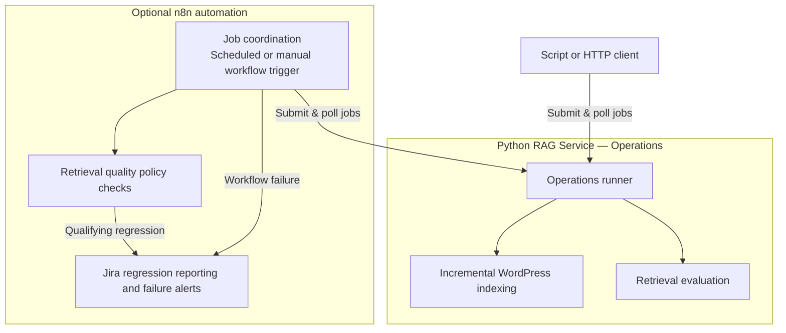

The operations runner executes incremental WordPress indexing and retrieval
evaluation jobs. It runs as a separate application from the [public API](/docs/search-and-answer/overview), which
serves search and answer requests.

You can submit an individual job and poll for its result from a script or HTTP
client. For regular updates, you can automate indexing on a schedule and
evaluate retrieval after WordPress content changes. The project provides an
optional workflow for [n8n](https://n8n.io/) (a tool for automating tasks across services) to
coordinate those jobs.

Both paths use the authenticated operations API and require a running
operations runner.

<figure>

<figcaption>Python RAG Service operations workflow</figcaption>
</figure>

## Key capabilities

### Keep WordPress content current

Incremental indexing updates the index when WordPress content is added, edited,
or removed. The indexing job reports whether it detected changes. The n8n
workflow submits a retrieval evaluation job only when indexing succeeds and
reports changes.

### Check retrieval quality

The runner writes reports for each evaluation job and returns a summary and
any failed case IDs in the job result. A successful job means the evaluation
finished and its reports were written. n8n makes the quality decision separately.

The n8n workflow compares results with an approved baseline after checking that
the dataset and retrieval configuration match and the required results are
available. Comparable results fail the retrieval quality policy if a metric
falls below its minimum, declines by more than the policy allows, or a case
that previously passed now fails. Missing evidence or a mismatch between the
run and the baseline can trigger a review.

### Route failures and regressions

The n8n workflow records a regression in Jira when a metric declines by more
than the policy allows or a case newly fails. A configured failure-alert
workflow can send an email notification when the indexing workflow fails, such as when
a runner job returns a failed status.

## When to use direct HTTP or n8n

- **Use a script or HTTP client** to verify the runner setup, submit a one-off
  indexing or evaluation job, or call the runner from automation you already
  maintain.
- **Use the optional n8n workflow** to schedule indexing and coordinate
  evaluation, quality checks, and reporting after content changes. You can also
  start the workflow manually.

## Next steps

- **[Run the operations runner](/docs/operations/run-operations-runner)**. Start the runner and verify that you can
  submit and poll jobs.
- **[How the n8n workflow works](/docs/operations/how-n8n-workflow-works)**: Understand
  job coordination, quality decisions, and regression reporting.
- **[Set up n8n workflow](/docs/operations/set-up-n8n-workflow)**. Set up scheduling, retrieval quality checks,
  and reporting.
